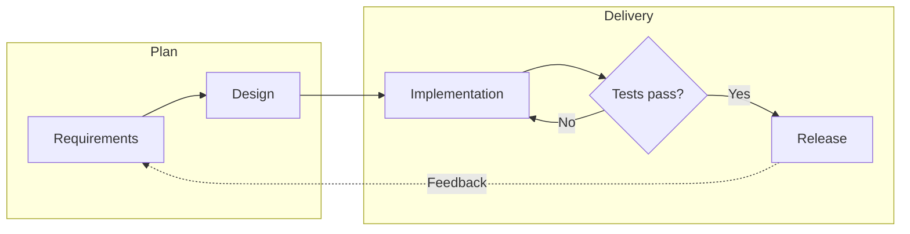

# Blue Topaz — Typora Dark Theme

**English** | [中文](README_CN.md)

Blue Topaz is a polished dark theme for [Typora](https://typora.io/), inspired by the [Nord](https://www.nordtheme.com/) palette and the [Blue-Topaz Obsidian theme](https://github.com/PKM-er/Blue-Topaz_Obsidian-css). It is designed for long-form writing, code-heavy notes, CJK text, and Mermaid diagrams.


## Highlights

- **Nord-based palette** — Polar Night backgrounds, Snow Storm text, and Aurora accents
- **Colored headings** — H1–H5 use distinct Aurora colors (red → orange → yellow → green → purple)
- **Material Palenight code highlighting** — Readable syntax colors with a focused editing panel
- **Mermaid styling** — Dark canvas, high-contrast nodes, clusters, labels, connectors, hover states, and print support
- **SVG task checkboxes** — Obsidian-inspired checkboxes with clear checked and unchecked states
- **Readable tables** — Zebra striping, rounded borders, and a blue hover overlay
- **Typography details** — Styled highlights, keyboard keys, links, quotes, and inline code
- **CJK optimized** — LXGW WenKai / 霞鹜文楷 font stack with sensible system fallbacks
- **Responsive and export friendly** — Mobile spacing and PDF/print rules are included

## Mermaid support

The theme styles Typora's Mermaid preview instead of embedding diagram-specific colors in each Markdown file. Flowcharts receive the most detailed treatment, while common sequence, state, and class diagram elements share the same Nord palette.



Mermaid diagrams include:

- A layered dark canvas with horizontal overflow for wide diagrams
- Rounded nodes, subtle shadows, and cyan hover outlines
- Purple decision nodes and dashed cluster boundaries
- High-contrast edge labels, arrowheads, notes, and tooltips
- Responsive padding and page-break protection when printing or exporting

## Installation

1. Download `blue-topaz.css`, or clone this repository:

   ```bash
   git clone https://github.com/YihanWn/typora-theme-blue-topaz.git
   ```

2. In Typora, open **Preferences → Appearance → Open Theme Folder**.
3. Copy `blue-topaz.css` into that folder.
4. Restart Typora.
5. Choose **Themes → Blue Topaz**.

Typical theme folders are:

| Platform | Theme folder |
| --- | --- |
| macOS | `~/Library/Application Support/abnerworks.Typora/themes/` |
| Windows | `%APPDATA%\Typora\themes\` |
| Linux | `~/.config/Typora/themes/` |

If an updated CSS file does not appear immediately, fully quit and reopen Typora so its theme cache is refreshed.

## Customization

The main colors and fonts are CSS custom properties near the top of `blue-topaz.css`.

| Variable | Purpose |
| --- | --- |
| `--bg-color-primary` | Editor background |
| `--text-color-primary` | Main text color |
| `--accent-blue` / `--accent-cyan` | Links, controls, and diagram accents |
| `--font-family-sans` | Body and Mermaid label font stack |
| `--font-family-mono` | Code font stack |
| `--mermaid-canvas` | Mermaid panel background |
| `--mermaid-node-bg` | Mermaid node fill |
| `--mermaid-node-border` | Mermaid node outline |
| `--mermaid-line` | Mermaid connectors and arrowheads |

After changing these variables, restart Typora before checking the result.

## Notes

- LXGW WenKai and JetBrains Mono are optional; the theme falls back to system fonts when they are unavailable.
- The theme is a single standalone CSS file and does not require a build step.
- Mermaid rendering details can vary slightly between Typora versions because Typora bundles its own Mermaid runtime.

## Credits

- Color palette: [Nord](https://www.nordtheme.com/)
- Original inspiration: [Blue-Topaz Obsidian Theme](https://github.com/PKM-er/Blue-Topaz_Obsidian-css)
- Checkbox approach inspired by [Drake Theme](https://github.com/liangjingkanji/DrakeTyporaTheme)

## License

MIT
