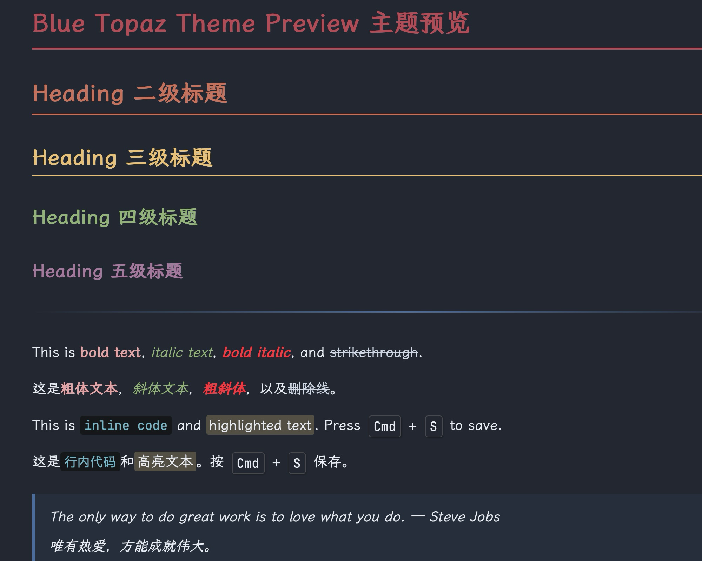

# Blue Topaz — Typora Dark Theme

**English** | [中文](README_CN.md)

A dark theme for Typora inspired by the [Nord](https://www.nordtheme.com/) color palette and [Blue-Topaz Obsidian theme](https://github.com/PKM-er/Blue-Topaz_Obsidian-css).

## Features

- **Nord-based color palette** — Polar Night backgrounds, Snow Storm text, Aurora accents
- **Colored headings** — H1–H5 each have a distinct Aurora color (red → orange → yellow → green → purple)
- **Material Palenight code highlighting** — Syntax colors inspired by Material Palenight
- **SVG custom checkboxes** — Obsidian-style task list checkboxes
- **Zebra-striped tables** — Alternating row colors with blue hover overlay
- **Fluorescent highlighter** — Warm yellow translucent `<mark>` styling
- **Keyboard shortcut styling** — Clean `<kbd>` rendering
- **CJK optimized** — LXGW WenKai / 霞鹜文楷 font support for Chinese text
- **Font ligatures** — Enabled for supported monospace fonts

## Screenshots

## Installation

1. Open Typora → `Preferences` → `Appearance` → `Open Theme Folder`
2. Copy `blue-topaz.css` into the theme folder
3. Restart Typora
4. Select **Blue Topaz** from the Themes menu

## Credits

- Color palette: [Nord](https://www.nordtheme.com/)
- Original inspiration: [Blue-Topaz Obsidian Theme](https://github.com/PKM-er/Blue-Topaz_Obsidian-css)
- Checkbox approach inspired by [Drake Theme](https://github.com/liangjingkanji/DrakeTyporaTheme)

## License

MIT
