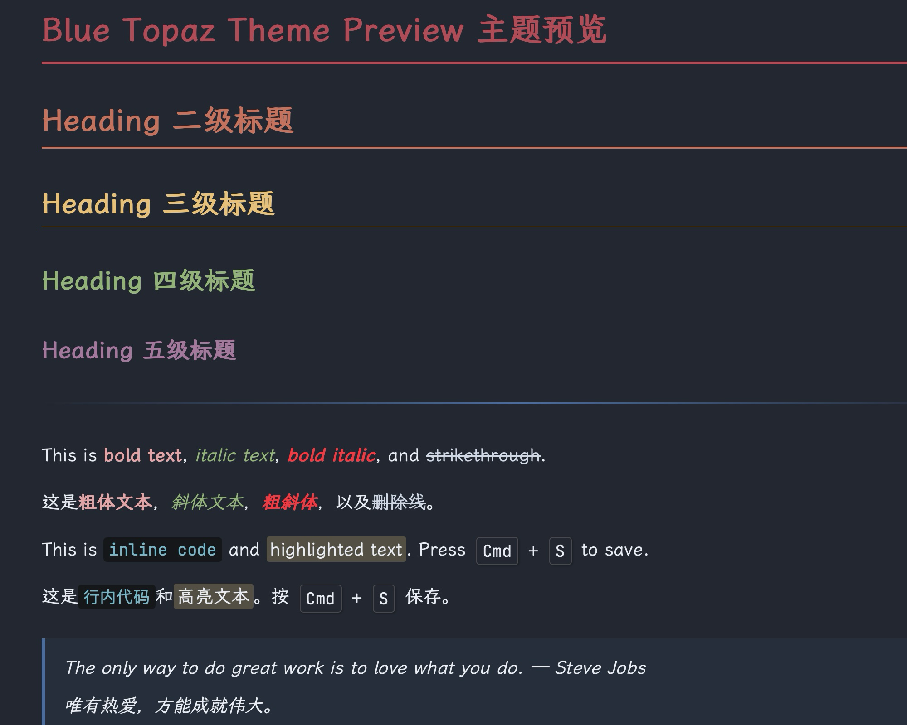
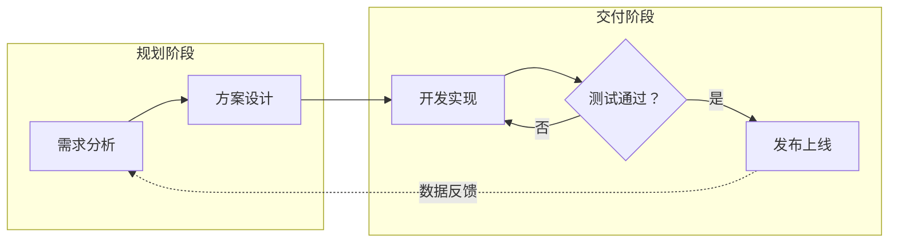

# Blue Topaz — Typora 暗色主题

[English](README.md) | **中文**

Blue Topaz 是一款精心打磨的 [Typora](https://typora.io/) 暗色主题，配色灵感来自 [Nord](https://www.nordtheme.com/) 与 [Blue-Topaz Obsidian 主题](https://github.com/PKM-er/Blue-Topaz_Obsidian-css)。它适合长文写作、技术笔记、中英文混排和 Mermaid 图表。



## 主要特性

- **Nord 配色** — Polar Night 背景、Snow Storm 文字与 Aurora 强调色
- **彩色标题** — H1–H5 分别使用红、橙、黄、绿、紫五种 Aurora 色彩
- **Material Palenight 代码高亮** — 清晰的语法配色和易辨识的代码编辑面板
- **Mermaid 图表优化** — 暗色画布、高对比节点、子图、标签、连线、悬停及打印样式
- **SVG 任务复选框** — Obsidian 风格的选中与未选中状态
- **易读表格** — 斑马纹、圆角边框与蓝色悬浮高亮
- **排版细节** — 对高亮、快捷键、链接、引用和行内代码进行了统一设计
- **CJK 优化** — 霞鹜文楷字体栈，并提供可靠的系统字体回退
- **响应式与导出支持** — 包含窄屏间距和 PDF/打印规则

## Mermaid 支持

主题会统一美化 Typora 的 Mermaid 预览，无需在每个 Markdown 文件里重复配置颜色。流程图拥有最完整的样式，同时覆盖时序图、状态图和类图中的常用元素。



Mermaid 图表包含以下优化：

- 分层暗色画布，宽图可横向滚动，避免内容被裁切
- 圆角节点、柔和阴影和青色悬停描边
- 紫色判断节点与虚线子图边界
- 高对比度的连线标签、箭头、注释和提示框
- 窄屏间距优化，以及打印和导出时的分页保护

## 安装

1. 下载 `blue-topaz.css`，或克隆本仓库：

   ```bash
   git clone https://github.com/YihanWn/typora-theme-blue-topaz.git
   ```

2. 在 Typora 中打开 **偏好设置 → 外观 → 打开主题文件夹**。
3. 将 `blue-topaz.css` 复制到该文件夹。
4. 重启 Typora。
5. 在 **主题 → Blue Topaz** 中启用主题。

常见主题文件夹位置：

| 平台 | 主题文件夹 |
| --- | --- |
| macOS | `~/Library/Application Support/abnerworks.Typora/themes/` |
| Windows | `%APPDATA%\Typora\themes\` |
| Linux | `~/.config/Typora/themes/` |

如果更新后的 CSS 没有立即生效，请完全退出并重新打开 Typora，以刷新主题缓存。

## 自定义

主要颜色与字体都定义在 `blue-topaz.css` 顶部的 CSS 变量中。

| 变量 | 用途 |
| --- | --- |
| `--bg-color-primary` | 编辑区背景 |
| `--text-color-primary` | 正文颜色 |
| `--accent-blue` / `--accent-cyan` | 链接、控件与图表强调色 |
| `--font-family-sans` | 正文及 Mermaid 标签字体 |
| `--font-family-mono` | 代码字体 |
| `--mermaid-canvas` | Mermaid 画布背景 |
| `--mermaid-node-bg` | Mermaid 节点填充色 |
| `--mermaid-node-border` | Mermaid 节点描边色 |
| `--mermaid-line` | Mermaid 连线与箭头颜色 |

修改变量后，请重启 Typora 再检查最终效果。

## 注意事项

- 霞鹜文楷和 JetBrains Mono 均为可选字体；未安装时会自动使用系统字体。
- 主题仅包含一个独立 CSS 文件，不需要构建或安装依赖。
- Typora 内置 Mermaid 运行时，不同 Typora 版本的渲染细节可能略有差异。

## 致谢

- 调色板：[Nord](https://www.nordtheme.com/)
- 灵感来源：[Blue-Topaz Obsidian Theme](https://github.com/PKM-er/Blue-Topaz_Obsidian-css)
- 复选框方案参考：[Drake Theme](https://github.com/liangjingkanji/DrakeTyporaTheme)

## 许可证

MIT
